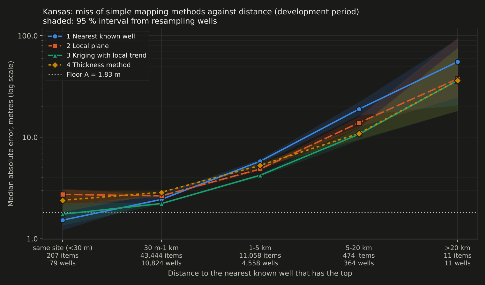

# Tops headroom test: report

First step of the blind drilling test. Brief of 13 November 2026, version 2.
Work done on 13 November 2026 in one Claude Code session.
Branch: `claude/kind-mendel-aqkrot` (the environment only allows pushes to this branch; the brief's name `blind-test-tops-headroom` was not used).

The question: when simple mapping methods forecast the depth of rock layer tops in a new well from earlier wells, how big is the miss, and how does it grow with distance from the nearest earlier well?

## First screen

### Pass or fail

| Country | Mark (a): enough hard wells | Mark (b): best simple method misses by at least 2 x floor A on far items | Verdict |
|---|---|---|---|
| **Kansas** | **Pass.** Far items come from 4,735 development wells (need 300). The sealed period holds 4,517 far wells (need 300). | **Pass.** Best of the four on far items is kriging: median absolute error 4.36 m (95 % interval 4.21 to 4.49 m), on 11,543 items. Floor A is 1.83 m (35,782 pairs). Ratio 2.38 (interval 2.30 to 2.45, floor held fixed). | **PASS** |
| **Netherlands** | Not started yet. | Not started yet. | Not done |

"Far" means the nearest known well with that top is more than 1 km away. All scores are from the development period only. The sealed period was counted, never scored.

### Three main findings

1. **Kansas has room, but not a lot.** On far items the best simple method misses by 4.36 m (14.3 ft). No method can beat about 1.83 m (6 ft). The gap is about 2.5 m.
2. **The miss grows steadily with distance.** Kriging misses by 2.22 m under 1 km, 4.22 m at 1 to 5 km, 10.68 m at 5 to 20 km. But 79 % of Kansas test items (43,651 of 55,194) have a known well with the top within 1 km. There the best method is already at 1.2 times the floor.
3. **Kriging with a local trend is the best of the four** at every distance beyond the same site. Its 80 % range holds the actual value 77.6 % of the time. The thickness method as the brief defines it is worse than kriging. A stronger variant I added as a side result gains only 0.15 m on far items (4.21 m) and does not change the verdict.

### Three main doubts

1. **The floor is coarse.** Kansas depths are whole feet, and floor A is exactly 6 ft. It mixes pick noise, elevation errors and real relief over 150 m. Mark (b) needs 3.66 m and the result is 4.36 m, so the pass is clear but the margin is under 1 m.
2. **Names of tops are not used the same way by everyone.** Most test wells report short names ("Anhydrite", "Topeka", "Lansing-Kansas City"). I merged them with the formal names. For Topeka, Kansas City, Marmaton, Fort Scott and Cherokee the picks of different sources often disagree by several metres. Part of the far miss on those tops is naming noise, not geology. Top by top the ratio runs from 1.44 (Stone Corral) to 5.46 (Kansas City).
3. **"Far" in Kansas is mostly 1 to 5 km.** Of 11,543 far items, 11,058 are at 1 to 5 km and only 485 are beyond 5 km. The pass rests on mid-range step-outs, not on true wildcats.

---

## Details

Facts come first in each section. My own reading is marked **Judgment**.

### 1. Data

**Kansas.** Kansas Geological Survey (KGS), statewide bulk files, both marked "October 9, 2026" on the download page <https://www.kgs.ku.edu/PRS/petroDB.html>. Downloaded 13 November 2026.

- `ks_wells.zip`: 519,691 well records. Used: KID, API number, latitude, longitude and their source, elevation and its reference, total depth, spud, completion and plugging dates, status, comments.
- `ks_tops.zip`: 2,135,525 top rows in 196,743 well records. Used: KID, elevation and reference, formation name, top depth, source of the pick.

What the KGS says about reuse (terms of use page <https://www.kgs.ku.edu/General/copyright.html>, "Updated July 2002"):

> "Information presented on this website has been developed for public use and may be distributed or copied."
> "The user is granted the right, without any fee or cost, to access, link to and use, publish, distribute, disseminate, transfer, or in any manner alter, modify, revise, copy, edit, or digitize this information."

It asks for this citation: "The source of this material is the Kansas Geological Survey website at http://www.kgs.ku.edu/. All Rights Reserved." The download page adds: "Tops are derived from various sources and are not necessarily confirmed by the KGS."

These terms clearly allow reuse. The cleaned input tables are committed: `data/kansas_wells.csv.gz` (15.8 MB) and `data/kansas_tops.csv.gz` (13.1 MB). They hold every row of the two files, with only the columns listed above.

No FORCE 2020 file was opened. No Norwegian data was used. Only KGS hosts were contacted for Kansas (`www.kgs.ku.edu`, `kgs.ku.edu`, `chasm.kgs.ku.edu`), plus the Python package index for installs. Every downloaded file is in `manifest.csv` with its source, date, size and sha256.

### 2. Cleaning (Kansas)

Elevations are in metres relative to sea level: elevation of the top = well elevation minus top depth, times 0.3048. Feet are kept as a second column in the result tables.

Choices, each with the count of wells left, are in the cleaning table below. The main ones:

- **What depths are measured from.** The file does not say what each top depth is measured from. I took it as the elevation reference listed for the well (KB kelly bushing, DF derrick floor, GL ground level, TOPO estimate). The elevation and reference in the tops file and in the wells file agree for every row. Wells with a GL or TOPO elevation are **flagged, not dropped**: 22,940 holes. For GL the depth may in fact be from a kelly bushing a few feet higher; I cannot correct this. TOPO elevations are estimates from a digital model.
- **Position.** Coordinates are NAD27, mostly worked out by the KGS from the legal description. Projected to metres with a Lambert conformal conic map projection, no datum change. Wells placed only at the centre of their section were dropped. Wells placed from quarter calls are kept and flagged (10,207 holes).
- **Deviated wells.** The file has no direction field. I dropped records whose API number has a sidetrack code (digits 11 and 12 not "00"). This is the rule the KGS itself uses for its horizontal-well list. I also dropped records whose comment mentions horizontal, directional, deviated, slant, sidetrack, whipstock, BHL or TVD. This removed 730 well records with tops. No true vertical depth is given for them.
- **Same hole.** Records with the same first 10 digits of the API number are one hole (re-entries, workovers). A re-entry is never a new well. 356 more holes were merged because another record had the same position, elevation, total depth and spud date.
- **Several picks of one top.** Within one record: the median. If they disagree by more than 100 ft the top is dropped for that record (8,153 cases). Across records of one hole: the earliest finished record that reports the top.
- **Dates.** A hole can be a test well only if every drilled record of it was spudded in 2000 or later and it has no completion or plugging date before 2000. A record's finish date is its completion date (the KGS defines this column as "Date of drilling finish"); the spud date if that is later; the plugging date if there is no completion date. Tops from a record with no finish date are never used as known wells.

**Names of tops.** The KGS column FORMATION has 6,203 different spellings. 393 differ only in upper or lower case or spacing and were merged. 53 more were merged by hand as spelling variants of the same top, such as "Heebner" with "Heebner Shale Member". Full map: `results/kansas_name_map.csv`. Evidence for each hand merge (wells that carry both names, and the depth difference): `results/kansas_name_map_evidence.csv`.

Names that mean another marker were **not** merged: "Lansing B" and other zones, "Cherokee Shale", "Mississippian Chert", "Simpson Sand", "Base Kansas City" and the like.

Three merges deserve a warning:

- "Anhydrite" (13,799 records, mostly after 2000) was merged with "Stone Corral Formation". This is a synonym, not a spelling. In the 105 records that carry both, the median depth difference is 4 ft and 65 % agree within 10 ft.
- "Lansing-Kansas City" was merged with "Lansing Group", because the top of that interval is the top of the Lansing. 41 records carry both; median difference 3 ft.
- "Topeka", "Fort Scott", "Marmaton" and "Cherokee" short names agree poorly with the formal names where both exist (median differences 51, 36.5, 15 and 16 ft). They are the same names, so I merged them, but these tops are picked inconsistently. Floor B shows the same thing for Topeka and Cherokee.

### 3. Split (Kansas)

Set from counts only, in the same run and before any scoring.

- Test wells: holes spudded in 2000 or later with at least one chosen top after cleaning: **26,877**.
- Ordered by spud date. Cut date **15 July 2010**. Development period: 13,435 wells spudded from 3 January 2000 up to the cut date. Sealed period: 13,442 wells spudded from the cut date to 27 July 2026.
- Files: `results/kansas_cut_date.txt`, `results/kansas_split.csv`, `results/kansas_sealed_wells.csv`.
- After the split the code removes every sealed well's depths from memory. Only the positions, dates and list of tops of sealed wells are kept, for counting.
- Known wells for a test well: finish date at least 12 months before the test well's spud date. Side run: no waiting time.

### 4. Methods

All four use only the known wells of each test well. All settings were chosen on wells spudded before 2000: pseudo-test wells spudded 1990 to 1999, known wells finished at least 12 months earlier. The setting with the lowest median absolute error won. The search grid and every score are in `results/kansas_tuning_grid.csv`, the chosen settings in `results/kansas_settings.json`.

1. **Nearest known well.** The elevation of the top in the nearest known well that has that top.
2. **Local plane.** A least-squares plane through the 8 nearest known wells with the top, read at the test well. If the wells do not span a plane, their mean.
3. **Kriging with a local trend.** Universal kriging with a linear trend in x and y, in a moving neighbourhood of the 24 nearest known wells. Variogram: nugget plus a power of distance, g(h) = r + h^a, with the shape (a and r) set per top on pre-2000 wells. The size of the variogram is estimated from the same 24 wells each time. The 80 % range is the kriging forecast plus or minus a Student-t quantile times the kriging standard deviation, times one multiplier set on pre-2000 wells (0.998, so almost nothing).
4. **Thickness method, exactly as run.** For a target top in a test well:
   - Take the chosen tops in order from shallow to deep.
   - Find the shallowest chosen top above the target that is "supported": at least 5 known wells with that top within 10 km. Forecast its elevation with method 3.
   - Go down to the target in as few steps as possible. A step from top A to a deeper top B is allowed if at least 5 known wells within 10 km report both. The thickness A to B is kriged (ordinary kriging, 16 nearest known wells that report both tops, wells with zero or negative thickness left out). Subtract it.
   - If the target cannot be reached from that start, try the next deeper start. If none works, use method 3 directly.
   - "As few steps as possible" was chosen on pre-2000 wells over "step through every chosen top in between" (median error 3.47 m against 4.82 m).

For methods 2, 3 and 4 a neighbour is left out if it lies more than max(6 x 1.4826 x MAD, 3 m) off the plane through its fellow neighbours. This was switched on because it lowered the error on pre-2000 wells (2.78 m against 3.03 m).

**Side method 4b (not one of the four, not in the pass marks).** The brief's method 4 always starts from the shallowest top. That is a weak choice when the target is well controlled. So I also ran a stronger variant: for each item take either direct kriging, or kriging of one overlying chosen top plus one kriged thickness, whichever has the smaller predicted error variance. It is reported next to the four so the reader can see that a better thickness method does not change the picture.

### 5. The floor (Kansas)

- **Floor A** (used in the pass marks): the same chosen top in two different holes less than 150 m apart, both with a precise position (from footages or GPS). No sealed wells. Median absolute difference **1.83 m** (6 ft), from 35,782 pairs in 12,915 different pairs of holes. This is far more than the 50 pairs needed, so the floor is reliable in the sense of the brief.
- With any position quality: 1.83 m (38,571 pairs). Without flagged elevations: 1.83 m (32,162 pairs).
- **Floor B**: two picks of the same top in the same hole from different sources. Median absolute difference **0.30 m** (1 ft), from 55,738 pairs. 42.1 % of the pairs are exactly equal, which suggests that many "different sources" are copies of one pick. Among pairs that differ, the median is 2.74 m.
- By top, floor A runs from 1.22 m (Heebner, Toronto) to 2.74 m (Simpson). See `results/kansas_floors.csv`.

**Judgment.** Floor A is the right one for the pass marks, as the brief says. It still contains some real geology (two holes 150 m apart are not the same place) and the GL and TOPO elevation noise. So it is, if anything, a little high, which makes mark (b) harder to pass.

### 6. Results (Kansas, development period)



One test item is one chosen top in one test well. 55,194 items in 13,435 wells. Every item had at least one known well with the top.

### Kansas: error by distance, development period

Median absolute error in metres, with the 95 % interval from resampling whole wells in brackets.

| Distance to nearest known well with the top | Items | Wells | 1 Nearest | 2 Plane | 3 Kriging | 4 Thickness | (side) 4b best route |
|---|---|---|---|---|---|---|---|
| all items | 55,194 | 13,435 | 3.05 (3.05-3.05) | 2.98 (2.93-3.03) | 2.53 (2.48-2.56) | 3.24 (3.19-3.31) | 2.46 (2.42-2.51) |
| far (>1 km) | 11,543 | 4,735 | 6.10 (5.79-6.40) | 5.03 (4.85-5.22) | 4.36 (4.21-4.49) | 5.41 (5.18-5.64) | 4.21 (4.07-4.34) |
| same site (<30 m) | 207 | 79 | 1.52 (1.22-2.13) | 2.73 (2.16-3.12) | 1.74 (1.36-2.25) | 2.39 (1.84-3.01) | 1.66 (1.26-2.28) |
| 30 m-1 km | 43,444 | 10,824 | 2.44 (2.44-2.74) | 2.65 (2.59-2.69) | 2.22 (2.18-2.26) | 2.87 (2.81-2.93) | 2.17 (2.14-2.21) |
| 1-5 km | 11,058 | 4,558 | 5.79 (5.49-6.10) | 4.86 (4.70-5.05) | 4.22 (4.09-4.36) | 5.28 (5.07-5.50) | 4.09 (3.97-4.22) |
| 5-20 km | 474 | 364 | 18.90 (16.46-22.25) | 13.88 (12.64-15.95) | 10.68 (9.34-12.32) | 10.89 (9.54-12.76) | 9.80 (8.47-11.49) |
| >20 km | 11 | 11 | 55.47 (20.73-92.96) | 37.57 (24.73-96.06) | 36.27 (18.18-75.98) | 36.27 (18.18-75.98) | 36.27 (18.18-75.98) |

The same medians in feet.

| Distance to nearest known well with the top | Items | Wells | 1 Nearest | 2 Plane | 3 Kriging | 4 Thickness | (side) 4b best route |
|---|---|---|---|---|---|---|---|
| all items | 55,194 | 13,435 | 10.0 | 9.8 | 8.3 | 10.6 | 8.1 |
| far (>1 km) | 11,543 | 4,735 | 20.0 | 16.5 | 14.3 | 17.7 | 13.8 |
| same site (<30 m) | 207 | 79 | 5.0 | 9.0 | 5.7 | 7.8 | 5.4 |
| 30 m-1 km | 43,444 | 10,824 | 8.0 | 8.7 | 7.3 | 9.4 | 7.1 |
| 1-5 km | 11,058 | 4,558 | 19.0 | 16.0 | 13.8 | 17.3 | 13.4 |
| 5-20 km | 474 | 364 | 62.0 | 45.5 | 35.0 | 35.7 | 32.1 |
| >20 km | 11 | 11 | 182.0 | 123.3 | 119.0 | 119.0 | 119.0 |

90th percentile of the absolute error in metres (95 % interval).

| Distance to nearest known well with the top | Items | Wells | 1 Nearest | 2 Plane | 3 Kriging | 4 Thickness | (side) 4b best route |
|---|---|---|---|---|---|---|---|
| all items | 55,194 | 13,435 | 15.2 (14.6-15.5) | 14.3 (13.9-14.6) | 11.0 (10.8-11.3) | 21.2 (20.2-22.1) | 10.7 (10.4-10.9) |
| far (>1 km) | 11,543 | 4,735 | 25.6 (24.4-26.8) | 24.2 (22.8-25.7) | 18.4 (17.5-19.4) | 28.8 (26.7-30.8) | 17.4 (16.6-18.2) |
| same site (<30 m) | 207 | 79 | 9.7 (8.2-14.5) | 9.1 (6.7-11.6) | 8.6 (6.6-11.0) | 14.8 (8.7-24.0) | 8.7 (7.0-11.2) |
| 30 m-1 km | 43,444 | 10,824 | 11.9 (11.3-12.2) | 11.7 (11.3-12.0) | 8.9 (8.7-9.1) | 18.7 (17.7-19.8) | 8.7 (8.5-8.9) |
| 1-5 km | 11,058 | 4,558 | 23.5 (22.3-24.4) | 22.4 (21.2-23.8) | 17.0 (16.3-17.8) | 27.3 (25.5-29.5) | 16.2 (15.6-16.9) |
| 5-20 km | 474 | 364 | 87.1 (64.7-100.6) | 66.3 (52.0-91.0) | 50.7 (39.0-63.3) | 51.7 (42.0-63.3) | 51.1 (39.9-63.3) |
| >20 km | 11 | 11 | 96.3 (63.9-97.5) | 97.9 (42.7-462.1) | 79.6 (37.2-81.3) | 79.6 (37.2-81.3) | 79.6 (37.2-81.3) |

Median signed error in metres (forecast minus actual; negative means the forecast was too deep).

| Distance to nearest known well with the top | Items | Wells | 1 Nearest | 2 Plane | 3 Kriging | 4 Thickness | (side) 4b best route |
|---|---|---|---|---|---|---|---|
| all items | 55,194 | 13,435 | -0.61 | -0.92 | -0.82 | -0.93 | -0.80 |
| far (>1 km) | 11,543 | 4,735 | -0.61 | -0.55 | -0.70 | -0.78 | -0.75 |
| same site (<30 m) | 207 | 79 | 0.00 | -1.32 | -0.49 | -0.73 | -0.40 |
| 30 m-1 km | 43,444 | 10,824 | -0.30 | -0.96 | -0.84 | -0.95 | -0.82 |
| 1-5 km | 11,058 | 4,558 | -0.61 | -0.56 | -0.74 | -0.80 | -0.77 |
| 5-20 km | 474 | 364 | -4.11 | -0.40 | 0.89 | 0.53 | 0.51 |
| >20 km | 11 | 11 | 23.47 | -24.73 | -18.18 | -18.18 | -18.18 |

### Kansas: how often the actual value is inside the 80 % range of method 3

| Distance band | Items | Wells | Actual inside the 80 % range | 95 % interval | Median half width, m |
|---|---|---|---|---|---|
| all items | 55,194 | 13,435 | 77.6 % | 77.1-78.1 % | 5.0 |
| far (>1 km) | 11,543 | 4,735 | 78.4 % | 77.5-79.4 % | 9.1 |
| same site (<30 m) | 207 | 79 | 64.7 % | 56.6-72.7 % | 2.6 |
| 30 m-1 km | 43,444 | 10,824 | 77.4 % | 76.9-78.0 % | 4.4 |
| 1-5 km | 11,058 | 4,558 | 78.3 % | 77.4-79.3 % | 8.8 |
| 5-20 km | 474 | 364 | 81.9 % | 78.2-85.2 % | 25.6 |
| >20 km | 11 | 11 | 63.6 % | 33.3-91.7 % | 64.2 |

### Kansas: median absolute error by top, metres

In a test well each top is one item, so items and wells are the same number here.

| Top (shallow to deep) | Items | n items | n wells | 1 Nearest | 2 Plane | 3 Kriging | 4 Thickness | (side) 4b best route | Floor A, m (pairs) | Best of four / floor A |
|---|---|---|---|---|---|---|---|---|---|---|
| Stone Corral Formation | all items | 5,722 | 5,722 | 1.83 | 1.93 | 1.56 | 1.56 | 1.56 |  |  |
| Stone Corral Formation | far (>1 km) | 744 | 744 | 3.05 | 3.28 | 2.63 | 2.63 | 2.63 | 1.83 (3,560) | 1.44 |
| Topeka Limestone Formation | all items | 4,538 | 4,538 | 3.05 | 3.55 | 2.83 | 3.10 | 2.80 |  |  |
| Topeka Limestone Formation | far (>1 km) | 881 | 881 | 5.49 | 6.39 | 5.27 | 4.98 | 4.66 | 2.13 (1,955) | 2.34 |
| Heebner Shale Member | all items | 9,666 | 9,666 | 2.13 | 2.18 | 1.86 | 2.51 | 1.85 |  |  |
| Heebner Shale Member | far (>1 km) | 1,468 | 1,468 | 4.57 | 3.24 | 2.99 | 3.80 | 2.96 | 1.22 (5,402) | 2.45 |
| Toronto Limestone Member | all items | 4,120 | 4,120 | 2.44 | 2.42 | 2.03 | 2.48 | 1.95 |  |  |
| Toronto Limestone Member | far (>1 km) | 809 | 809 | 4.57 | 3.79 | 3.11 | 3.71 | 2.73 | 1.22 (1,930) | 2.55 |
| Lansing Group | all items | 9,977 | 9,977 | 2.44 | 2.51 | 2.16 | 2.84 | 2.10 |  |  |
| Lansing Group | far (>1 km) | 1,484 | 1,484 | 4.88 | 4.00 | 3.50 | 4.29 | 3.45 | 1.83 (8,032) | 1.91 |
| Kansas City Group | all items | 1,102 | 1,102 | 5.49 | 8.35 | 5.26 | 13.62 | 5.53 |  |  |
| Kansas City Group | far (>1 km) | 415 | 415 | 13.72 | 14.13 | 11.65 | 14.30 | 10.51 | 2.13 (2,038) | 5.46 |
| Marmaton Group | all items | 3,440 | 3,440 | 4.57 | 4.09 | 3.72 | 4.47 | 3.49 |  |  |
| Marmaton Group | far (>1 km) | 1,213 | 1,213 | 7.01 | 5.50 | 5.01 | 5.82 | 4.49 | 2.13 (759) | 2.35 |
| Fort Scott Limestone Formation | all items | 3,115 | 3,115 | 4.27 | 4.07 | 3.56 | 4.38 | 3.54 |  |  |
| Fort Scott Limestone Formation | far (>1 km) | 1,074 | 1,074 | 7.01 | 6.12 | 5.53 | 6.55 | 5.17 | 2.13 (1,689) | 2.59 |
| Cherokee Group | all items | 3,269 | 3,269 | 4.57 | 3.85 | 3.59 | 4.96 | 3.49 |  |  |
| Cherokee Group | far (>1 km) | 1,008 | 1,008 | 7.32 | 5.50 | 4.86 | 6.72 | 5.07 | 2.44 (1,147) | 1.99 |
| Mississippian System | all items | 5,929 | 5,929 | 4.88 | 4.47 | 3.85 | 6.53 | 3.88 |  |  |
| Mississippian System | far (>1 km) | 1,798 | 1,798 | 7.62 | 6.81 | 5.43 | 7.27 | 5.38 | 2.44 (2,828) | 2.23 |
| Simpson Group | all items | 597 | 597 | 5.18 | 4.83 | 3.70 | 13.54 | 3.70 |  |  |
| Simpson Group | far (>1 km) | 182 | 182 | 9.52 | 8.08 | 5.78 | 27.75 | 5.80 | 2.74 (975) | 2.11 |
| Arbuckle Group | all items | 3,719 | 3,719 | 4.57 | 5.16 | 4.48 | 5.05 | 4.08 |  |  |
| Arbuckle Group | far (>1 km) | 467 | 467 | 10.97 | 8.68 | 7.45 | 11.19 | 6.91 | 2.44 (5,467) | 3.05 |

### Kansas: the floor

| Floor | Pairs | Different hole pairs / holes | Median absolute difference, m | 90th percentile, m | Share exactly zero |
|---|---|---|---|---|---|
| A: two holes under 150 m apart, both positions precise (used in pass marks) | 35,782 | 12,915 | 1.83 | 9.45 | 5.5 % |
| A-all: two holes under 150 m apart, any position quality | 38,571 | 14,416 | 1.83 | 9.75 | 5.7 % |
| A-clean: as A, both holes without an elevation flag | 32,162 | 10,626 | 1.83 | 9.14 | 5.6 % |
| B: two picks of one top in one hole from different sources | 55,738 | 13,837 | 0.30 | 14.02 | 42.1 % |

### Kansas: side results

No waiting time (known wells = finished before the test well was spudded). Median absolute error, metres (95 % interval).

| Distance to nearest known well with the top | Items | Wells | 1 Nearest | 2 Plane | 3 Kriging | 4 Thickness | (side) 4b best route |
|---|---|---|---|---|---|---|---|
| all items | 55,194 | 13,435 | 2.74 (2.74-2.74) | 2.79 (2.75-2.84) | 2.32 (2.29-2.35) | 3.06 (3.00-3.12) | 2.27 (2.23-2.30) |
| far (>1 km) | 8,752 | 3,761 | 6.10 (5.79-6.40) | 5.04 (4.81-5.24) | 4.37 (4.19-4.53) | 5.43 (5.16-5.66) | 4.21 (4.06-4.37) |
| same site (<30 m) | 233 | 91 | 1.52 (1.22-2.13) | 2.67 (2.14-3.04) | 1.66 (1.29-2.21) | 2.38 (1.72-3.01) | 1.55 (1.16-2.17) |
| 30 m-1 km | 46,209 | 11,535 | 2.44 (2.44-2.44) | 2.54 (2.51-2.59) | 2.10 (2.07-2.13) | 2.77 (2.71-2.83) | 2.06 (2.02-2.09) |
| 1-5 km | 8,389 | 3,624 | 5.79 (5.49-6.10) | 4.86 (4.65-5.08) | 4.24 (4.07-4.41) | 5.30 (5.08-5.56) | 4.09 (3.94-4.24) |
| 5-20 km | 354 | 260 | 19.81 (16.15-22.56) | 13.41 (11.27-14.93) | 10.44 (9.10-12.34) | 10.50 (8.90-12.76) | 9.76 (8.44-11.70) |
| >20 km | 9 | 9 | 55.47 (17.98-131.06) | 34.85 (15.95-100.08) | 24.28 (9.56-80.33) | 24.28 (9.56-80.33) | 24.28 (9.56-80.33) |

Only holes without an elevation flag and with a precise position, as test wells and as known wells (200 resamples). Median absolute error, metres (95 % interval).

| Distance to nearest known well with the top | Items | Wells | 1 Nearest | 2 Plane | 3 Kriging | 4 Thickness | (side) 4b best route |
|---|---|---|---|---|---|---|---|
| all items | 51,397 | 11,554 | 2.74 (2.74-3.05) | 2.89 (2.85-2.95) | 2.44 (2.40-2.49) | 3.15 (3.08-3.21) | 2.38 (2.34-2.42) |
| far (>1 km) | 10,232 | 3,799 | 5.79 (5.78-6.10) | 4.88 (4.70-5.12) | 4.22 (4.09-4.38) | 5.30 (5.09-5.55) | 4.06 (3.92-4.21) |
| same site (<30 m) | 184 | 64 | 1.52 (0.91-2.13) | 2.47 (1.96-2.97) | 1.66 (1.10-2.22) | 2.22 (1.59-2.76) | 1.51 (1.10-2.07) |
| 30 m-1 km | 40,981 | 9,702 | 2.44 (2.44-2.44) | 2.59 (2.54-2.63) | 2.17 (2.13-2.21) | 2.80 (2.72-2.86) | 2.12 (2.08-2.16) |
| 1-5 km | 9,721 | 3,591 | 5.49 (5.49-5.79) | 4.65 (4.49-4.85) | 4.09 (3.93-4.21) | 5.12 (4.96-5.40) | 3.92 (3.77-4.06) |
| 5-20 km | 476 | 322 | 21.79 (18.27-24.38) | 15.10 (12.47-16.39) | 9.56 (8.56-11.13) | 9.86 (8.58-11.24) | 9.18 (8.26-10.57) |
| >20 km | 35 | 33 | 51.21 (30.02-58.85) | 37.57 (20.16-52.80) | 33.82 (15.55-47.64) | 33.82 (15.55-47.64) | 33.82 (15.55-47.64) |

### Kansas: sealed period, counts only

| Count of | Number |
|---|---|
| sealed wells | 13442 |
| sealed items (chosen top reported in a sealed well) | 64634 |
| sealed far items (nearest known well with the top more than 1 km away) | 14479 |
| sealed items with no known well at all for the top | 0 |
| sealed wells with at least one far item | 4517 |
| sealed items, nearest known well same site (<30 m) | 261 |
| sealed items, nearest known well 30 m-1 km | 49894 |
| sealed items, nearest known well 1-5 km | 14075 |
| sealed items, nearest known well 5-20 km | 400 |
| sealed items, nearest known well >20 km | 4 |

### Kansas: chosen tops

| Order (top down) | Top | Holes drilled before the test years that report it |
|---|---|---|
| 1 | Stone Corral Formation | 68,311 |
| 2 | Topeka Limestone Formation | 43,290 |
| 3 | Heebner Shale Member | 92,941 |
| 4 | Toronto Limestone Member | 50,085 |
| 5 | Lansing Group | 109,294 |
| 6 | Kansas City Group | 48,548 |
| 7 | Marmaton Group | 27,797 |
| 8 | Fort Scott Limestone Formation | 24,994 |
| 9 | Cherokee Group | 33,711 |
| 10 | Mississippian System | 56,548 |
| 11 | Simpson Group | 22,841 |
| 12 | Arbuckle Group | 54,403 |

Next three, not chosen: Winfield Limestone Formation (21,124); Chase Group (20,352); Viola Limestone Formation (19,529).

### Kansas: cleaning steps and wells left

| Step | Well records left | Holes left | Detail |
|---|---|---|---|
| 0. all records in the wells file | 519,691 | 474,876 | 356 holes merged into another hole as duplicates (same position, elevation, depth, spud date) |
| 1. records with at least one top row | 196,743 | 194,621 | 2135525 top rows |
| 2. top depth present, above 0 and not over 12,000 ft | 195,530 | 193,453 | 2052549 top rows left. Rows with no top depth (base only), zero or negative depth, or a depth deeper than any Kansas well are dropped. |
| 3. top not deeper than the well's total depth plus 50 ft | 195,003 | 192,950 | 2035617 top rows left. A pick below the bottom of the hole is a data error. |
| 4. elevation and its reference present, and the same in the wells file and the tops file | 194,989 | 192,936 | 2035512 top rows left. 0 top rows had a different elevation or reference in the two files. |
| 5. usable position | 194,802 | 192,752 | 2034482 top rows left. Dropped: position given only as the centre of the section (up to about 1 km off), unknown source, or outside Kansas. |
| 6. not horizontal or deviated | 194,072 | 192,061 | 2030207 top rows left. Dropped: records whose API number carries a sidetrack code (digits 11-12 not 00, the KGS's own rule for its horizontal-well list) or whose comment mentions horizontal, directional, deviated, slant, sidetrack, whipstock, BHL or TVD. The file gives no true vertical depth or top position for them. |
| 7. one elevation per hole and top | 193,417 | 192,045 | 1824531 hole-top values. Picks of one top in one record from several sources: the median. 8153 record-top groups dropped because their picks disagree by more than 100 ft. Records of one hole (re-entries, workovers; same first 10 digits of the API number): the earliest finished record that reports the top is used (14120 record-top values were in holes with more than one record for that top). |
| 8. holes in the analysis | 193,417 | 192,045 | 22940 holes flagged for elevation (GL or TOPO), 10207 flagged for position from quarter calls, 3555 holes whose records sit more than 30 m apart. Flagged holes are kept. |
| 9. holes with a valid first spud date |  | 189,252 | spud before 2000: 158325; can be a test well (every drilled record spudded in 2000 or later, no completion or plugging date before 2000): 30258. Dates outside 1860 to 9 Oct 2026 were treated as missing: {'SPUD': 5, 'COMPLETION': 9, 'PLUGGING': 20}. |
| 10. holes whose tops can serve as known wells (finish date present) |  | 190,931 | Finish date = completion date; the spud date if it is later; the plugging date if there is no completion date. Holes with none of these are never used as known wells. |

### Kansas: settings (all set on wells drilled before the test years)

| Top | Wells used | Variogram power | Nugget ratio r |
|---|---|---|---|
| Stone Corral Formation | 24 | 1.5 | 0.3 |
| Topeka Limestone Formation | 24 | 1.5 | 0.1 |
| Heebner Shale Member | 24 | 1.0 | 0.03 |
| Toronto Limestone Member | 24 | 0.5 | 0.03 |
| Lansing Group | 24 | 1.0 | 0.1 |
| Kansas City Group | 24 | 1.0 | 0.1 |
| Marmaton Group | 24 | 1.0 | 0.01 |
| Fort Scott Limestone Formation | 24 | 1.0 | 0.1 |
| Cherokee Group | 24 | 1.0 | 0.03 |
| Mississippian System | 24 | 0.5 | 0.3 |
| Simpson Group | 24 | 1.0 | 0.1 |
| Arbuckle Group | 24 | 1.0 | 0.1 |

Method 2 uses the 8 nearest known wells. Outlier screening of neighbours: on (drop a neighbour more than max(6 x 1.4826 x MAD, 3 m) off the local plane). Thickness kriging: 16 nearest wells, power 0.5, nugget ratio 0.03, constant local mean. Thickness chain: fewest layers, support = at least 5 known wells within 10 km. Multiplier on the 80 % range: 0.998 (coverage before the multiplier on the pre-test-year check: 80.1 %).

Check on wells drilled before the test years (4,000 sampled wells, same date rule; 80 % range of method 3 held the actual value 79.7 % of the time):

| Method | Items | Median abs error, m | 90th percentile, m | Far items | Median abs error far, m |
|---|---|---|---|---|---|
| 1 Nearest | 17,131 | 3.35 | 14.9 | 4,143 | 6.10 |
| 2 Plane | 17,131 | 3.22 | 14.3 | 4,143 | 4.71 |
| 3 Kriging | 17,131 | 2.63 | 11.2 | 4,143 | 4.29 |
| 4 Thickness | 17,131 | 3.47 | 18.5 | 4,143 | 5.06 |
| (side) 4b best route | 17,131 | 2.57 | 10.7 | 4,143 | 4.11 |

Other facts from these tables:

- **Forecasts are too deep by about 0.8 m on the median** (kriging: -0.82 m). New wells come in slightly higher than the map from older wells says.
- **No waiting time** changes little: kriging goes from 2.53 m to 2.32 m on all items and stays at 4.37 m on far items. With no waiting time fewer items are far (8,752 against 11,543).
- **Without flagged wells** (no GL or TOPO elevation, no quarter-call position) the far miss of kriging is 4.22 m and floor A is 1.83 m: the same picture.
- **Sealed period, counts only:** 13,442 wells, 64,634 items, 14,479 far items in 4,517 wells.

**Judgment.** The steady bias is what one would expect if operators drill where they hope the layer is high. A method that knew this could gain a few tenths of a metre. The pass in Kansas is real but narrow in metres: a new method has to beat 4.36 m on far items and cannot go below about 1.83 m.

### 7. Checks

- **Date-rule test** (`src/check_date_rule.py`, run by the one command). It reads the dates again from the input tables with separate code and checks every known well behind every forecast. Kansas: 551,940 forecasts checked (main run and no-waiting-time run; five forecasts per item, the four methods and side method 4b), 11,296,020 uses of a known well checked, **0 violations**. Output: `results/date_rule_check.txt`.
- **Spot-check sheet:** `results/kansas_spot_check.csv`. 20 random test items. For each: the test well, its spud date, the latest finish date allowed, every known well used by each method with its finish date, distance and value, each forecast and the actual value. For methods 2 to 4 the sheet lists all neighbours taken; a few of them may have been left out by the outlier screen.
- **Rerun:** `./run.sh` goes from `data/` to `results/` in about 5 minutes. I ran it twice; every result file had the same sha256 both times (`hashes.txt`).

### 8. What I could not do or verify

- I could not check what each top depth is measured from. The file does not say. See section 2.
- I could not check deviation beyond the API code and the comments. Some deviated wells without that code may remain. Kansas wells are mostly vertical.
- I did not check any pick against a log. A wrong pick in a test well counts as a miss of the method.
- "Known" is decided by the finish date of the well, as the brief says. I did not check when each pick was made or released. Some picks on old wells were made later by KGS projects. They are treated as known from the well's finish date.
- The sealed period was not scored. I cannot say whether its errors look like the development period.
- The 95 % intervals resample wells. They do not include the uncertainty of the floor or of the settings.
- Wells in one field are not independent. The well-resampled intervals are probably too narrow.

### 9. How to rerun

```
cd blind_test/tops_headroom
python3 -m venv .venv && .venv/bin/pip install -r requirements.txt
./run.sh                      # data/ -> results/, date-rule test, hashes.txt   (about 5 min per country)
.venv/bin/python -I src/build_report.py     # report_src.md + result tables -> report.md
```

To rebuild `data/` from the source: `./download_kansas.sh`, then `.venv/bin/python -I src/prepare_kansas.py` and `.venv/bin/python -I src/make_manifest.py`. The KGS files change over time; `manifest.csv` holds the hashes of the files used here.

Files: `src/` code; `data/` cleaned input tables; `results/` tables, chart, name maps, split, spot-check sheet; `manifest.csv` downloads; `hashes.txt` sha256 of every download, input table and result file.
