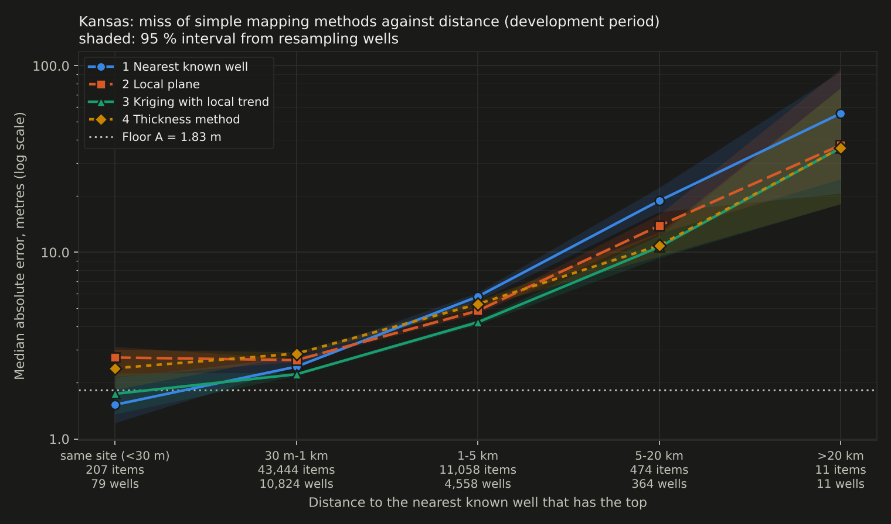
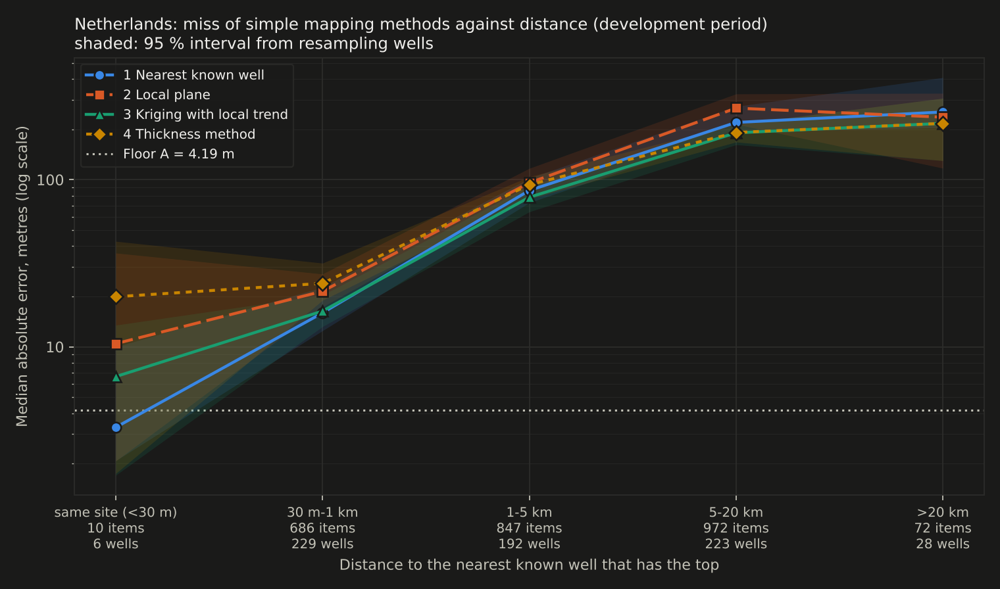

# Tops headroom test: report

First step of the blind drilling test. Brief of 13 November 2026, version 2.
Work done on 13 November 2026 in one Claude Code session.
Branch: `claude/kind-mendel-aqkrot` (the environment only allows pushes to this branch; the brief's name `blind-test-tops-headroom` was not used).

The question: when simple mapping methods forecast the depth of rock layer tops in a new well from earlier wells, how big is the miss, and how does it grow with distance from the nearest earlier well?

## First screen

### Pass or fail

| Country | Mark (a): enough hard wells | Mark (b): best simple method misses by at least 2 x floor A on far items | Verdict |
|---|---|---|---|
| **Kansas** | **Pass.** Far items come from 4,735 development wells (need 300). The sealed period holds 4,517 far wells (need 300). | **Pass.** Best of the four on far items is kriging: median absolute error 4.36 m (95 % interval 4.21 to 4.49 m), on 11,543 items. Floor A is 1.83 m (35,782 pairs). Ratio 2.38 (interval 2.30 to 2.45, floor held fixed). | **PASS** |
| **Netherlands** | **Pass, narrowly.** Far items come from 371 development wells (need 300). The sealed period holds 342 far wells (need 300). | **Pass.** Best of the four on far items is kriging: median absolute error 122.4 m (95 % interval 108.0 to 141.8 m), on 1,891 items. Floor A is 4.19 m (7,139 pairs). Ratio 29.2 (interval 25.8 to 33.8, floor held fixed). | **PASS** |

"Far" means the nearest known well with that top is more than 1 km away. All scores are from the development period only. The sealed period was counted, never scored.

### Three main findings

1. **Both countries pass, but they are very different.** Kansas has a little room: the best simple method misses far tops by 4.36 m, against a floor of 1.83 m. The Netherlands has a lot: 122 m against a floor of 4.19 m.
2. **The miss grows steadily with distance.** Kriging in Kansas: 2.2 m under 1 km, 4.2 m at 1 to 5 km, 10.7 m at 5 to 20 km. Kriging in the Netherlands: 16 m, 78 m and 191 m. In Kansas 79 % of test items have a known well with the top within 1 km, and there the best method is at 1.2 times the floor. In the Netherlands only 27 % do, and even there the miss is 4 times the floor.
3. **Kriging with a local trend is the best of the four in both countries**, and its 80 % range is roughly honest (it holds the actual value 77.6 % of the time in Kansas, 74.2 % in the Netherlands). The thickness method as the brief defines it is worse than kriging. A stronger thickness variant that I added as a side result changes nothing (far miss 4.21 m in Kansas, 122.8 m in the Netherlands). Forecasts are biased: 0.8 m too deep in Kansas, 42 m too shallow on far items in the Netherlands.

### Three main doubts

1. **The Kansas margin is small and its floor is coarse.** Kansas depths are whole feet and floor A is exactly 6 ft. Mark (b) needs 3.66 m; the result is 4.36 m. Top by top the ratio runs from 1.44 (Stone Corral) to 5.46 (Kansas City). "Far" in Kansas is mostly 1 to 5 km (11,058 of 11,543 far items).
2. **Picks are not all made the same way, and I could not check when they were made.** In Kansas most test wells use short names ("Anhydrite", "Topeka", "Lansing-Kansas City") that I merged with the formal names; for some tops different sources disagree by metres. In the Netherlands 76 % of the top rows of holes finished before 1990 carry a source code with a later year in its name ("RGD1997", "ONSHORE2004" and the like). So a known well's pick may have been revised with knowledge of later wells, even of the test wells. That would make the simple methods look better than they were, not worse.
3. **The Dutch test is small and leans on deviated wells.** 535 development wells, 371 of them far; the sealed count of 342 is only just over 300 and had to use surface positions. 363 of the 535 development wells are deviated or horizontal. I forecast each top at the place where the test well actually crossed it, which a real forecast would know only roughly.

---

## Details

Facts come first in each section. My own reading is marked **Judgment**.

### 1. Data

**Kansas.** Kansas Geological Survey (KGS), statewide bulk files, both marked "October 9, 2026" on the download page <https://www.kgs.ku.edu/PRS/petroDB.html>. Downloaded 13 November 2026.

- `ks_wells.zip`: 519,691 well records. Used: KID, API number, latitude, longitude and their source, elevation and its reference, total depth, spud, completion and plugging dates, status, comments.
- `ks_tops.zip`: 2,135,525 top rows in 196,743 well records. Used: KID, elevation and reference, formation name, top depth, source of the pick.

What the KGS says about reuse (terms of use page <https://www.kgs.ku.edu/General/copyright.html>, "Updated July 2002"):

> "Information presented on this website has been developed for public use and may be distributed or copied."
> "The user is granted the right, without any fee or cost, to access, link to and use, publish, distribute, disseminate, transfer, or in any manner alter, modify, revise, copy, edit, or digitize this information."

It asks for this citation: "The source of this material is the Kansas Geological Survey website at http://www.kgs.ku.edu/. All Rights Reserved." The download page adds: "Tops are derived from various sources and are not necessarily confirmed by the KGS."

These terms clearly allow reuse. The cleaned input tables are committed: `data/kansas_wells.csv.gz` (15.8 MB) and `data/kansas_tops.csv.gz` (13.1 MB). They hold every row of the two files, with only the columns listed above.

**Netherlands.** NLOG, the Dutch oil and gas portal. Downloaded 13 November 2026.

- `thematische_data_boringen.zip` from <https://www.nlog.nl/en/boreholes> ("Combined data selections by type"). Files inside are dated 23 September 2026. Used: `nlog_stratstelsel_20260923.csv`, the lithostratigraphy of all boreholes: 111,651 rows in 6,517 wellbores. Columns used: wellbore, borehole system, the borehole that drilled the interval, top and base along hole, true vertical depth of the top, unit code and name, anomaly code, position of the top (ED50 UTM zone 31), source of the interpretation.
- The borehole list: "All boreholes" from NLOG's page <https://www.nlog.nl/en/files-interactive-map>: 6,739 boreholes. Columns used: code, borehole or sidetrack, type, start and end date of drilling, shape (vertical, deviated, horizontal), on or offshore, reference level, its height and what it is relative to, position.

**A point about rule 4.** NLOG's page links the borehole list on another host, `www.gdngeoservices.nl`, the map server of the Geological Survey of the Netherlands. The list is not a file on `nlog.nl`. I stopped and asked. Ammar approved that host on 13 November 2026 and I downloaded that one file from it, nothing else. The borehole overview inside NLOG's "datacenter" web app was **not** used: it has no published file link.

What NLOG says about reuse (disclaimer page <https://www.nlog.nl/en/disclaimer>):

> "NLOG.NL does not claim any rights (except domain names, trademark rights, patents and other intellectual property rights) in respect of information provided on or through this website. Users are permitted to copy, to download and to disclose in any way, to distribute or to simplify the information provided on this website without the prior written permission of NLOG.NL or the lawful consent of the entitled party. Users are also permitted to copy, duplicate, process or edit the information and/or layout, provided NLOG.NL is quoted as the source."

Its data page adds: "Well logs, cuttings, cores and the accompanying reports are available after a statutory five-year confidentiality period. Administrative data are available to the public immediately."

These terms clearly allow reuse with NLOG named as the source. The cleaned input tables are committed: `data/netherlands_wells.csv.gz` (0.15 MB) and `data/netherlands_tops.csv.gz` (1.74 MB). **Judgment:** the borehole list is offered "through" the NLOG website, so I read the same terms as covering it; I did not look for separate terms on the map server.

All four committed input tables together are 30.8 MB, under the 50 MB limit.

No FORCE 2020 file was opened. No Norwegian data was used. Hosts contacted: `www.kgs.ku.edu`, `kgs.ku.edu`, `chasm.kgs.ku.edu`, `www.nlog.nl`, `www.gdngeoservices.nl` (one file, approved), and the Python package index for installs. Every downloaded file is in `manifest.csv` with its source, date, size and sha256.

### 2. Cleaning (Kansas)

Elevations are in metres relative to sea level: elevation of the top = well elevation minus top depth, times 0.3048. Feet are kept as a second column in the result tables.

Choices, each with the count of wells left, are in the cleaning table below. The main ones:

- **What depths are measured from.** The file does not say what each top depth is measured from. I took it as the elevation reference listed for the well (KB kelly bushing, DF derrick floor, GL ground level, TOPO estimate). The elevation and reference in the tops file and in the wells file agree for every row. Wells with a GL or TOPO elevation are **flagged, not dropped**: 22,940 holes. For GL the depth may in fact be from a kelly bushing a few feet higher; I cannot correct this. TOPO elevations are estimates from a digital model.
- **Position.** Coordinates are NAD27, mostly worked out by the KGS from the legal description. Projected to metres with a Lambert conformal conic map projection, no datum change. Wells placed only at the centre of their section were dropped. Wells placed from quarter calls are kept and flagged (10,207 holes).
- **Deviated wells.** The file has no direction field. I dropped records whose API number has a sidetrack code (digits 11 and 12 not "00"). This is the rule the KGS itself uses for its horizontal-well list. I also dropped records whose comment mentions horizontal, directional, deviated, slant, sidetrack, whipstock, BHL or TVD. This removed 730 well records with tops. No true vertical depth is given for them.
- **Same hole.** Records with the same first 10 digits of the API number are one hole (re-entries, workovers). A re-entry is never a new well. 356 more holes were merged because another record had the same position, elevation, total depth and spud date.
- **Several picks of one top.** Within one record: the median. If they disagree by more than 100 ft the top is dropped for that record (8,153 cases). Across records of one hole: the earliest finished record that reports the top.
- **Dates.** A hole can be a test well only if every drilled record of it was spudded in 2000 or later and it has no completion or plugging date before 2000. A record's finish date is its completion date (the KGS defines this column as "Date of drilling finish"); the spud date if that is later; the plugging date if there is no completion date. Tops from a record with no finish date are never used as known wells.

**Names of tops.** The KGS column FORMATION has 6,203 different spellings. 393 differ only in upper or lower case or spacing and were merged. 53 more were merged by hand as spelling variants of the same top, such as "Heebner" with "Heebner Shale Member". Full map: `results/kansas_name_map.csv`. Evidence for each hand merge (wells that carry both names, and the depth difference): `results/kansas_name_map_evidence.csv`.

Names that mean another marker were **not** merged: "Lansing B" and other zones, "Cherokee Shale", "Mississippian Chert", "Simpson Sand", "Base Kansas City" and the like.

Three merges deserve a warning:

- "Anhydrite" (13,799 records, mostly after 2000) was merged with "Stone Corral Formation". This is a synonym, not a spelling. In the 105 records that carry both, the median depth difference is 4 ft and 65 % agree within 10 ft.
- "Lansing-Kansas City" was merged with "Lansing Group", because the top of that interval is the top of the Lansing. 41 records carry both; median difference 3 ft.
- "Topeka", "Fort Scott", "Marmaton" and "Cherokee" short names agree poorly with the formal names where both exist (median differences 51, 36.5, 15 and 16 ft). They are the same names, so I merged them, but these tops are picked inconsistently. Floor B shows the same thing for Topeka and Cherokee.

### 2b. Cleaning (Netherlands)

Counts after each step are in the cleaning table in section 6b.

- **Vertical reference.** The file gives the true vertical depth of each top below NAP (onshore) or mean sea level (offshore). The NLOG description of the file says so. Elevation = minus that depth, in metres. Nothing had to be converted. I did not correct for the small difference between NAP and mean sea level.
- **Check of the reference.** Where a wellbore's first interval starts at 0 m along hole, its vertical depth should be minus the reference height in the borehole list. It agrees within 0.05 m in 66.1 % of 6,308 wellbores and within 1 m in 97.5 %. Holes off by more than 1 m are flagged, not dropped (118 holes in the analysis). The source marks no elevation as an estimate.
- **Deviated wells are kept.** The file gives the true vertical depth and the position of every top, which is the brief's condition for keeping them. Holes in the analysis: 2,109 vertical, 3,084 deviated, 278 horizontal. No hole was removed for being deviated. Distances are measured between the positions of the tops, not between wellheads.
- **Which rows are tops.** A row is used only if it is a named member, formation, subgroup or group; the true vertical depth and position are present; the interval directly above it in the same wellbore is an interpreted unit (so the top is a drilled boundary, not the surface, a gap, a fault row or the edge of a "NOT INTERPRETED" stretch); and its upper boundary is not marked as a kick-off point, a fault or uncertain. Tops that are unconformities are kept.
- **Same hole.** NLOG lists a sidetrack as its own borehole, and repeats the picks above the kick-off point in the table of the mother borehole and of each sidetrack. I removed the 13,907 copies. A hole in this test is a borehole or sidetrack with the tops it drilled itself. A sidetrack is never a test well. Its own picks count as known data once it is finished. A borehole and its sidetracks are never paired for the floor. Sidetracks of sealed wells are sealed with them.
- **One level of the naming scheme.** Counted after cleaning, the member level has the most data (60,342 hole-top values, against 45,717 at formation level and 22,740 at group level, with members rolled up). So the chosen tops are members. The file uses the codes of the Dutch nomenclature, so there are no spelling variants to merge; the name map (`results/netherlands_name_map.csv`) lists the 209 member codes with their names.
- **A tie at place 12.** Z2 Salt Member and Grey Salt Clay Member are both reported in 843 holes finished before 1990. I took the first in code order, Z2 Salt Member.
- **Dates.** Test wells are mother boreholes (not sidetracks) whose drilling ended in 1990 or later. Known wells for a test well: drilling ended at least 5 years before the test well's start date of drilling. Side run: no waiting time.

### 3. Split (Kansas)

Set from counts only, in the same run and before any scoring.

- Test wells: holes spudded in 2000 or later with at least one chosen top after cleaning: **26,877**.
- Ordered by spud date. Cut date **15 July 2010**. Development period: 13,435 wells spudded from 3 January 2000 up to the cut date. Sealed period: 13,442 wells spudded from the cut date to 27 July 2026.
- Files: `results/kansas_cut_date.txt`, `results/kansas_split.csv`, `results/kansas_sealed_wells.csv`.
- After the split the code removes every sealed well's depths from memory. Only the positions, dates and list of tops of sealed wells are kept, for counting.
- Known wells for a test well: finish date at least 12 months before the test well's spud date. Side run: no waiting time.

### 3b. Split (Netherlands)

- Test wells: 1,251 mother boreholes finished in 1990 or later have tops; **1,070** of them have at least one chosen top.
- Ordered by end date of drilling. Cut date **30 March 2001**. Development period: 535 wells finished from 16 January 1990 up to the cut date (172 vertical, 324 deviated, 39 horizontal; 288 onshore, 247 offshore). Sealed period: 535 wells finished from the cut date to 16 October 2025.
- Files: `results/netherlands_cut_date.txt`, `results/netherlands_split.csv`, `results/netherlands_sealed_wells.csv`.
- As in Kansas, sealed depths are removed from memory right after the split. For counting far wells in the sealed period I used the surface position of each sealed borehole, not the position of its tops, because the position of a top in a deviated hole depends on its depth.

### 4. Methods

All four use only the known wells of each test well. All settings were chosen on wells drilled before the test years, with the same date rule. Kansas: pseudo-test wells spudded 1990 to 1999. Netherlands: pseudo-test wells finished 1975 to 1989. The setting with the lowest median absolute error won. The search grids and every score are in `results/<country>_tuning_grid.csv`, the chosen settings in `results/<country>_settings.json` and in the settings tables below. The numbers quoted in this section are the Kansas ones.

In the Netherlands every forecast is made at the position of the top in the test well. For the thickness method, a known hole gives a thickness only if its two tops lie within 250 m of each other in plan; the thickness is placed at the lower top.

1. **Nearest known well.** The elevation of the top in the nearest known well that has that top.
2. **Local plane.** A least-squares plane through the 8 nearest known wells with the top, read at the test well. If the wells do not span a plane, their mean.
3. **Kriging with a local trend.** Universal kriging with a linear trend in x and y, in a moving neighbourhood of the 24 nearest known wells. Variogram: nugget plus a power of distance, g(h) = r + h^a, with the shape (a and r) set per top on pre-2000 wells. The size of the variogram is estimated from the same 24 wells each time. The 80 % range is the kriging forecast plus or minus a Student-t quantile times the kriging standard deviation, times one multiplier set on pre-2000 wells (0.998, so almost nothing).
4. **Thickness method, exactly as run.** For a target top in a test well:
   - Take the chosen tops in order from shallow to deep.
   - Find the shallowest chosen top above the target that is "supported": at least 5 known wells with that top within 10 km. Forecast its elevation with method 3.
   - Go down to the target in as few steps as possible. A step from top A to a deeper top B is allowed if at least 5 known wells within 10 km report both. The thickness A to B is kriged (ordinary kriging, 16 nearest known wells that report both tops, wells with zero or negative thickness left out). Subtract it.
   - If the target cannot be reached from that start, try the next deeper start. If none works, use method 3 directly.
   - "As few steps as possible" was chosen on pre-2000 wells over "step through every chosen top in between" (median error 3.47 m against 4.82 m).

For methods 2, 3 and 4 a neighbour is left out if it lies more than max(6 x 1.4826 x MAD, 3 m) off the plane through its fellow neighbours. In Kansas this was switched on because it lowered the error on pre-2000 wells (2.78 m against 3.03 m). In the Netherlands the same search left it off, and chose 4 wells for the plane, 12 or 24 wells for kriging and 8 wells for thickness kriging (see the settings tables).

**Side method 4b (not one of the four, not in the pass marks).** The brief's method 4 always starts from the shallowest top. That is a weak choice when the target is well controlled. So I also ran a stronger variant: for each item take either direct kriging, or kriging of one overlying chosen top plus one kriged thickness, whichever has the smaller predicted error variance. It is reported next to the four so the reader can see that a better thickness method does not change the picture.

### 5. The floor

**Kansas.**

- **Floor A** (used in the pass marks): the same chosen top in two different holes less than 150 m apart, both with a precise position (from footages or GPS). No sealed wells. Median absolute difference **1.83 m** (6 ft), from 35,782 pairs in 12,915 different pairs of holes. This is far more than the 50 pairs needed, so the floor is reliable in the sense of the brief.
- With any position quality: 1.83 m (38,571 pairs). Without flagged elevations: 1.83 m (32,162 pairs).
- **Floor B**: two picks of the same top in the same hole from different sources. Median absolute difference **0.30 m** (1 ft), from 55,738 pairs. 42.1 % of the pairs are exactly equal, which suggests that many "different sources" are copies of one pick. Among pairs that differ, the median is 2.74 m.
- By top, floor A runs from 1.22 m (Heebner, Toronto) to 2.74 m (Simpson). See `results/kansas_floors.csv`.

**Netherlands.**

- **Floor A**: the same chosen top in two different hole systems, picks less than 150 m apart. Median absolute difference **4.19 m**, from 7,139 pairs in 2,470 different pairs of holes. Reliable in the sense of the brief (more than 50 pairs).
- Vertical holes only: 2.88 m (2,063 pairs).
- By top it runs from 2.48 m (Coppershale, Z2 Carbonate) to 15.45 m (Z2 Salt). See `results/netherlands_floors.csv`.
- **Floor B is not available.** The file holds one interpretation per borehole. No hole has the same top from two sources.

**Judgment.** Floor A is the right one for the pass marks, as the brief says. It still contains some real geology (two holes 150 m apart are not the same place) and, in Kansas, the GL and TOPO elevation noise. So it is, if anything, a little high, which makes mark (b) harder to pass. In the Netherlands the floor does not matter for the verdict: the far miss is 29 times larger.

### 6. Results (Kansas, development period)



One test item is one chosen top in one test well. 55,194 items in 13,435 wells. Every item had at least one known well with the top.

<!-- TABLES:kansas -->

Other facts from these tables:

- **Forecasts are too deep by about 0.8 m on the median** (kriging: -0.82 m). New wells come in slightly higher than the map from older wells says.
- **No waiting time** changes little: kriging goes from 2.53 m to 2.32 m on all items and stays at 4.37 m on far items. With no waiting time fewer items are far (8,752 against 11,543).
- **Without flagged wells** (no GL or TOPO elevation, no quarter-call position) the far miss of kriging is 4.22 m and floor A is 1.83 m: the same picture.
- **Sealed period, counts only:** 13,442 wells, 64,634 items, 14,479 far items in 4,517 wells.

**Judgment.** The steady bias is what one would expect if operators drill where they hope the layer is high. A method that knew this could gain a few tenths of a metre. The pass in Kansas is real but narrow in metres: a new method has to beat 4.36 m on far items and cannot go below about 1.83 m.

### 6b. Results (Netherlands, development period)



2,587 items in 535 wells. Every item had at least one known well with the top.

<!-- TABLES:netherlands -->

Other facts from these tables:

- **Forecasts are too shallow on far items**: the median signed error of kriging is +42.5 m there (forecast higher than the actual top). Within 1 km there is no clear bias (-2.1 m).
- **No waiting time** helps more than in Kansas: kriging goes from 78.7 m to 54.6 m on all items and from 122.4 m to 94.1 m on far items.
- **Vertical holes only** (89 far wells): the far miss of kriging is 192.8 m and floor A is 2.88 m. The vertical test wells are mostly far step-outs.
- **Sealed period, counts only:** 535 wells, 2,229 items, 1,158 far items in 342 wells (by surface position).

**Judgment.** The Dutch far miss is large because the geology is rough (salt, faults, inverted basins) and wells are far apart: over half of the far items are more than 5 km from the nearest known well with the top. The bias suggests that old wells sit on highs and later wells step off them. The pass on mark (b) is beyond doubt. The pass on mark (a) is thin: 371 and 342 against a need of 300.

### 7. Checks

- **Date-rule test** (`src/check_date_rule.py`, run by the one command). It reads the dates again from the input tables with separate code and checks every known well behind every forecast (main run and no-waiting-time run; five forecasts per item: the four methods and side method 4b). Output: `results/date_rule_check.txt`.
  - Kansas: 551,940 forecasts checked, 11,296,020 uses of a known well checked, **0 violations**.
  - Netherlands: 25,870 forecasts checked, 329,706 uses of a known well checked, **0 violations**.
- **Spot-check sheets:** `results/kansas_spot_check.csv` and `results/netherlands_spot_check.csv`. 20 random test items each. For each: the test well, its spud date, the latest finish date allowed, every known well used by each method with its finish date, distance and value, each forecast and the actual value. For methods 2 to 4 the sheet lists all neighbours taken; in Kansas a few of them may have been left out by the outlier screen.
- **Rerun:** `./run.sh` goes from `data/` to `results/` in about 6 minutes for both countries. I ran each country twice; every result file had the same sha256 both times (`hashes.txt`). After the code was extended for the Netherlands I ran Kansas again: every Kansas number was unchanged.

### 8. What I could not do or verify

- I could not check what each top depth is measured from. The file does not say. See section 2.
- I could not check deviation beyond the API code and the comments. Some deviated wells without that code may remain. Kansas wells are mostly vertical.
- I did not check any pick against a log. A wrong pick in a test well counts as a miss of the method.
- "Known" is decided by the finish date of the well, as the brief says. I did not check when each pick was made or released. Some picks on old wells were made later by KGS projects. They are treated as known from the well's finish date.
- The sealed period was not scored. I cannot say whether its errors look like the development period.
- Netherlands: I could not check when each interpretation was made. The file gives a source code per row (the largest are EINDSLIP, RGD1997, ONSHORE2004, GE-KRT2018V3). The NLOG description does not explain the codes. Going only by the year in the code's name, 60 % of all rows, and 76 % of the rows of holes finished before 1990, were interpreted more than 5 years after the hole was finished. Such picks may have been made with later wells in view, including test wells. The date rule in this test goes by when the hole was finished, as the brief says, so it does not catch this.
- Netherlands: each top is forecast at the place where the test well crossed it. Before drilling only the planned path is known. For a deviated well the true crossing point depends on the depth being forecast. I did not measure this effect.
- Netherlands: the sealed far-well count (342) uses surface positions. With top positions it could be somewhat different. I did not compute that, so as not to touch sealed depths.
- Netherlands: I used the brief's 5-year rule. I did not check each well's real release date.
- The 95 % intervals resample wells. They do not include the uncertainty of the floor or of the settings.
- Wells in one field are not independent. The well-resampled intervals are probably too narrow.

### 9. Where the work was blocked

- **Branch.** This environment only lets me push to `claude/kind-mendel-aqkrot`. The brief's branch name was not used. Nothing was committed to `main`. No force-push, no rewritten history.
- **Push.** The first push was refused (403: the Claude GitHub App had no write access to the repository). I stopped, sent Ammar a git bundle as a backup and asked. He fixed the access and the push then worked.
- **Dutch borehole list.** See section 1: the file sits on `www.gdngeoservices.nl`. I stopped and asked; Ammar approved that host.
- **Order of work.** Kansas was finished and pushed (commit `bfc76a0`) before any Dutch file was downloaded.
- Nothing else blocked the work. No rule was worked around.

### 10. How to rerun

```
cd blind_test/tops_headroom
python3 -m venv .venv && .venv/bin/pip install -r requirements.txt
./run.sh                      # data/ -> results/, date-rule test, hashes.txt   (about 6 min; "./run.sh kansas" for one country)
.venv/bin/python -I src/build_report.py     # report_src.md + result tables -> report.md
```

To rebuild `data/` from the sources: `./download_kansas.sh` and `./download_netherlands.sh`, then `.venv/bin/python -I src/prepare_kansas.py`, `.venv/bin/python -I src/prepare_netherlands.py` and `.venv/bin/python -I src/make_manifest.py`. The source files change over time; `manifest.csv` holds the hashes of the files used here.

Files: `src/` code; `data/` cleaned input tables; `results/` tables, chart, name maps, split, spot-check sheet; `manifest.csv` downloads; `hashes.txt` sha256 of every download, input table and result file.
