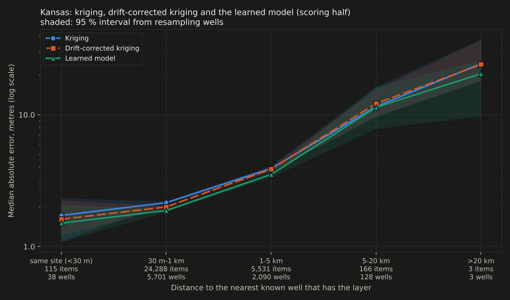
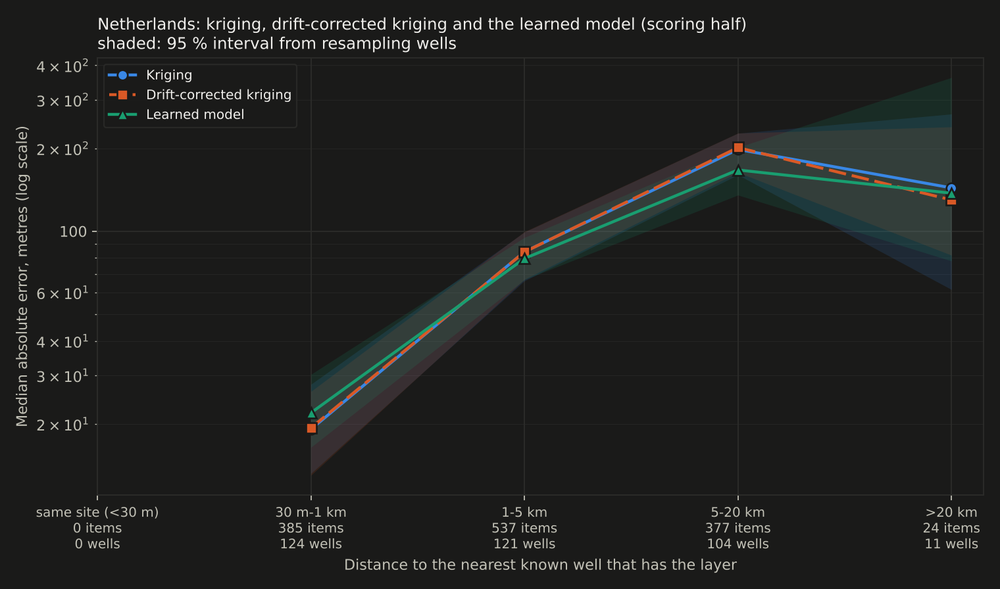

# Tops learned test: report

Brief 2 of 13 November 2026: can a learned model beat mapping on layer depths?
Work done on 13 November 2026 in one Claude Code session, the same session that made the first run.
Branch: `claude/kind-mendel-aqkrot`. Folder: `blind_test/tops_learned/`. Nothing in `blind_test/tops_headroom/` was changed.

The question: on wells far from earlier wells, can a quick learned model beat the best simple method, after a fair correction for drift?

## First screen

### Pass or fail

The pass mark: on the far items of the scoring half, the learned model C must have a median absolute error at least 10 % below the best simple method, and the 95 % interval of that improvement must lie above zero.

| Country | Far items | Best simple method | Learned model C | Improvement | Verdict |
|---|---|---|---|---|---|
| **Kansas** | 5,700 items in 2,162 wells | Side method 4b: 3.87 m | 3.60 m | 7.1 % (95 % interval 3.9 to 9.5) | **FAIL.** The gain is real but under 10 %. |
| **Netherlands** | 938 items in 194 wells | Side method 4b: 109.4 m | 101.2 m | 7.5 % (95 % interval -5.7 to 21.9) | **FAIL.** Under 10 %, and the interval includes zero. |

How much of the gain the drift-only model D already gets: almost none. On far items D improves on the best simple method by 0.1 % in Kansas (interval -3.4 to 2.7) and by 0.4 % in the Netherlands (interval -13.1 to 18.5). That is 2 % and 5 % of C's gain.

"Far" means the nearest known well with that layer is more than 1 km away. The scoring half was scored once, with models frozen in commit `c7b367c6622aec5959c8c7dd20c0b33f2ea3c1df`.

### Three main findings

1. **Kansas: the learned model beats every simple method, but not by enough.** On far items it is 7.1 % better than the best simple method and 10.0 % better than kriging (interval 7.2 to 12.8). With shuffled targets the gain is gone (-3.0 %), so it is not an artefact. In metres it is small: 0.28 m on a miss of 3.87 m.
2. **The gain is not drift.** The drift-only model, which sees no depth value, gains nothing over the best simple method in either country. Drift-corrected kriging is not the best simple method in either country. The correction removes most of the bias (Kansas far items: from -1.03 m to -0.42 m; C reaches -0.10 m) but hardly moves the median miss. What helps C is depth information: in Kansas three quarters of the model's split gain sits in depth features, led by the routes through other layers.
3. **The Netherlands cannot be told apart from no gain.** The point estimate is like Kansas (7.5 %) but the interval runs from -5.7 % to +21.9 %. In Kansas the gain is larger near known wells (10.7 % at 30 m to 1 km) than far from them (6.4 % at 1 to 5 km, nothing measurable beyond 5 km). So the learned model does not help most where mapping is weakest.

### Three main doubts

1. **The Dutch result is mostly noise.** 938 far items in 194 wells. Two side models whose training sets differ by 129 of 11,307 items score 102.0 m and 109.9 m. The Dutch fail means "not shown", not "shown to be absent".
2. **This was a quick model.** One model family, a dozen settings tried per country (7 for C, 5 for D), features fixed beforehand, all built in under two hours. A more careful model might pass in Kansas, where the miss is 3 points (7.1 % against 10 %) and the top of the interval is 9.5 %. I cannot say from this run.
3. **The doubts of the first run still stand**, because the data are the same: picks in Kansas are named and made unevenly, Dutch picks may have been revised with later wells in view, and Dutch tops are forecast where the well actually crossed them. One new one: as the brief allows, the model trains on the whole tuning half, whose newest wells were not yet "known" for the first scoring wells. A side model without them scores the same (Kansas 3.57 m, Netherlands 102.0 m), so this did not drive the result.

---

## Details

Facts come first in each section. My own reading is marked **Judgment**.

### 1. Data and what was loaded

- Only the four cleaned input tables of the first run were read (`blind_test/tops_headroom/data/`). Nothing was downloaded. No FORCE 2020 file, no Norwegian data.
- The first run's code is imported, not copied and not changed: its loaders, its date rule, its four methods and side method 4b, and its settings (`results/<country>_settings.json` of the first run).
- **Sealed wells.** The first run's loaders read every row and dropped sealed depths afterwards. That is not allowed here. So this run reads the tables through a guard (`src/safe_load.py`): the depth columns of blocked rows are skipped while the file is read and are never parsed. Blocked are all rows of sealed wells, of their sidetracks and of their duplicate records, and, to be safe, every record dated on or after the start of the sealed period. Such records can never be a known well for a development well, so nothing usable is lost.
- **Scoring half.** During training the same guard also blocks every record dated on or after the start of the scoring half. The training stage cannot see a depth of the scoring half.
- The guard proves itself on every load: no sealed well, no sidetrack of one and (in training) no scoring-half well has a value in memory.
- Kansas depth columns guarded: top depth, and total depth of the well. Netherlands: depth along hole of top and base, true vertical depth of the top, and the position of the top (in a deviated hole it follows from the depth).

### 2. Split of the development period

Set from dates only, from the first run's split files, before any model was fitted. Committed first, in commit `01433f2`.

| Country | Development wells | Date between the halves | Tuning half | Scoring half |
|---|---|---|---|---|
| Kansas | 13,435 | 12 April 2006 | 6,716 wells, 3 Jan 2000 to 11 Apr 2006 | 6,719 wells, 12 Apr 2006 to 14 Jul 2010 |
| Netherlands | 535 | 2 September 1994 | 267 wells, 16 Jan 1990 to 13 Aug 1994 | 268 wells, 2 Sep 1994 to 27 Mar 2001 |

Files: `results/kansas_dev_split.csv`, `results/netherlands_dev_split.csv`, `results/dev_split_dates.txt`. The date is the one the first run ordered by: spud date in Kansas, end of drilling in the Netherlands.

### 3. Training targets

- **From before the test years.** Kansas: wells spudded 1970 to 1999. Netherlands: mother boreholes finished 1950 to 1989. Each is forecast at its own date, only from wells known then under the first run's date rule (finished at least 12 months before the spud date in Kansas, at least 5 years before the start of drilling in the Netherlands).
- **Plus the tuning half**, forecast the same way.
- Every choice was made by fitting on the targets from before the test years and looking at the tuning half. The final models were then fitted on both together with those choices.
- The start years 1970 and 1950 were set by me beforehand and not tuned.

### 4. What is compared

One test item is one chosen layer in one well of the scoring half. The 12 chosen layers per country are those of the first run.

**A. The four simple methods and side method 4b of the first run**, with the first run's settings: nearest known well, local plane, kriging with a local trend, thickness method, and the best-route variant 4b.

**B. Drift-corrected kriging.** Kriging plus one number per layer and distance band: the median of (actual minus kriging) over training targets. A cell with fewer than 30 targets uses the layer's median. Which years of targets to use was chosen on the tuning half among: all, the last 20, the last 10, the last 5 years. The final table uses that many years up to the start of the scoring half, so it includes the tuning half. Table: `results/<country>_drift_table.csv`.

**C. The learned model.** Gradient-boosted trees (LightGBM) that forecast the miss of kriging, actual minus kriging. The forecast is kriging plus the predicted miss. One model per country, all layers together, with the layer as a feature. Loss: absolute error. 160 features, listed with their group in `results/features.csv`:

- position: x and y of the forecast point, and the layer (3);
- dates: date of the test well, and how long before it each of the 8 nearest known wells was finished (12);
- distances: to the 8 nearest known wells with the layer, to the nearest known well with each other layer, to the nearest well that has both layers (34);
- counts: known wells within 0.5, 1, 2, 5, 10 and 20 km, and wells with both layers within 10 km (19);
- directions: east and north offset of the 8 nearest known wells, how one-sided they are (19);
- depth values (73): the outputs of the simple methods relative to kriging, the kriging spread, the values of the 8 nearest known wells relative to kriging, the local dip, the kriged elevation of each other chosen layer at the same spot, and "routes": kriging of another layer plus or minus a kriged thickness to the target layer, from above and from below.

No feature uses a pick of the test well, for any layer. Features for other layers are forecasts from known wells at the test well's position, not the test well's own values.

**D. The drift-only model.** The same trees, but only the 68 features of the groups position, dates, distances and counts. It sees no depth value and no output of a simple method. Its forecast is kriging plus its predicted miss.

**80 % range of C.** Two more tree models forecast the 10th and 90th percentile of the miss. One number, set on the tuning half, widens or narrows the range so that it held 80 % there.

**Choices made on the tuning half** (yardstick: median absolute error on its far items): whether the target is divided by the kriging spread (C only), whether far items weigh three times as much, tree size (four settings), and the number of trees. Every fit and its score is in `results/<country>_tuning_search.csv`; the choices are in `results/<country>_settings_learned.json` and in the tables below.

**Side models, not in the pass mark.**
- C trained on shuffled targets (the shuffle test).
- C trained only on targets from before the test years.
- C trained only on targets whose actual value was already known, under the date rule, before the first well of the scoring half was started. The brief lets the model train on the whole tuning half. But the newest tuning wells were not yet "known wells" for the first scoring wells. Because the model sees the position, it could carry their depths into forecasts nearby. This side model shows whether that matters.

### 5. Results

Scoring half, scored once. Kansas: 6,719 wells, 30,103 items. Netherlands: 268 wells, 1,323 items. Every well of the scoring half has at least one item.

**Kansas**



<!-- TABLES:kansas -->

**Netherlands**



<!-- TABLES:netherlands -->

**Facts drawn from the tables**

- **Pass mark, Kansas.** Best simple method on far items: side method 4b, 3.87 m. C: 3.60 m. Improvement 7.1 % (3.9 to 9.5). Fail: under 10 %.
- **Pass mark, Netherlands.** Best simple method on far items: side method 4b, 109.4 m. C: 101.2 m. Improvement 7.5 % (-5.7 to 21.9). Fail: under 10 % and the interval includes zero.
- **If side method 4b is left out** (it was my addition in the first run, not one of the brief's four): the best simple method is drift-corrected kriging in Kansas (3.97 m; C is 9.4 % better, interval 6.8 to 11.9) and plain kriging in the Netherlands (112.5 m; C is 10.1 % better, interval -4.0 to 22.4). Both would still fail.
- **Drift.** Against the best simple method D gains 0.1 % (Kansas) and 0.4 % (Netherlands) on far items. Against plain kriging D gains 3.2 % in Kansas (0.9 to 5.0) and 3.1 % in the Netherlands (-9.8 to 18.4), about a third of what C gains against kriging. Drift-corrected kriging B gains 0.7 % over kriging in Kansas and loses 1.5 % in the Netherlands.
- **Bias on far items** (median of forecast minus actual). Kansas: kriging -1.03 m, B -0.42 m, D -0.38 m, C -0.10 m. Netherlands: kriging +41.8 m, B +31.9 m, D +14.8 m, C -1.1 m.
- **All items.** Kansas: C 2.11 m, best simple there is B with 2.24 m (C 6.1 % better, 5.1 to 7.3). Netherlands: C 73.0 m, 4b 71.1 m (C 2.6 % worse, -12.8 to 11.3).
- **Mean absolute error, far items.** Kansas: 4b 9.59 m, C 9.17 m (4.3 % lower). Netherlands: 4b 183.8 m, C 170.4 m, D 167.9 m.
- **80 % range.** C's range holds the actual value 82.2 % of the time in Kansas (kriging 78.1 %) and 78.4 % in the Netherlands (kriging 72.9 %). On far items: 79.3 % against 78.7 % in Kansas, 75.8 % against 70.3 % in the Netherlands. The ranges are about as wide as kriging's.
- **Where C puts its weight.** Share of split gain in depth features: 74 % in Kansas, 57 % in the Netherlands. In Kansas the three largest features are routes through other layers (the median of all routes 13.8 %, the route through the Heebner 9.2 %, side method 4b 8.8 %). In the Netherlands no single feature has more than 1.5 %. Feature names: `L<n>` is the n-th chosen layer counted from the top, starting at 0.
- **Side models.** Trained only on targets already known before the scoring half: Kansas 3.57 m, Netherlands 102.0 m. Trained only on targets from before the test years: Kansas 3.64 m, Netherlands 109.9 m.

**Judgment.** In Kansas there is a real edge for a learned model, about 7 % on far items and about 10 % near wells, and it comes mainly from using the other layers at the same spot, not from knowing that new wells run high. It is too small to pass, and in metres it is a quarter of a metre. In the Netherlands the test is too small to see an effect of this size: an honest reading is "no evidence either way". If the aim is to beat mapping where it is weakest, far from wells, this run gives no support: the edge shrinks with distance in Kansas.

### 6. Checks

All four checks passed.

- **Date-rule test, extended to every known well behind every feature** (`src/checks.py`). Each feature is built from stored lists of known wells; the test reads the dates again from the input tables with the first run's independent code and checks each known well against each test well's start date. It also checks that the pipeline's own dates agree.
  - Scoring half: Kansas 15,291,760 uses of a known well, Netherlands 1,127,196. **0 violations.**
  - Training targets and tuning half: Kansas 182,271,584 uses, Netherlands 10,047,299. **0 violations.**
- **Own-pick test.** Two parts.
  - On every item above: the known wells behind a feature never include the test well itself, nor (Netherlands) a sidetrack of its hole system. 0 cases.
  - On 60 random scoring wells per country (280 items in Kansas, 273 in the Netherlands): every pick of the test well was shifted by 137 m and its features were built again. No feature and no simple-method forecast moved, in any well. As a control the same shift was given to the nearest known well instead: the features moved in all 60 wells, so the test can fail.
  - In the rehearsal on the tuning half this test first reported 2 Kansas wells. The cause was the test itself: it put values back by subtracting 137, which does not always restore the last digit. It now restores saved copies. This was fixed before the frozen commit.
- **Shuffle test.** C trained with the same settings on shuffled targets, scored on the far items of the scoring half. Kansas: 3.99 m, that is -3.0 % against the best simple method (-6.2 to -0.2) and +0.2 % against kriging (-1.2 to 1.9). Netherlands: 110.1 m, -0.6 % against the best simple method (-9.7 to 7.6) and +2.2 % against kriging (-7.2 to 7.8). The gain vanishes.
- **Frozen models.** Before scoring, the script checked the sha256 of 10 files per country (models, drift table, settings, feature list) against `results/model_hashes.json` of commit `c7b367c`.
- **Rerun with one command.** After scoring, `./run.sh` was run again in full (22 minutes). It rebuilt all 14 model files, the drift tables and the feature list with the same sha256 as in the frozen commit. Every table, per-item file and chart of the scoring half came out byte for byte the same. The only differences were the run-time fields ("seconds") in the two settings files and the two tuning-search files; I kept the committed versions of those four files. Seeds are fixed in the code.

Two more facts about agreement with the first run:

- The guard changes nothing it should not. Netherlands: the 1,323 scoring items are exactly the first run's, with the same actual values and the same kriging forecasts. Kansas: 30,103 of the first run's 30,115 scoring-half items. The 12 missing ones took their actual value from a record dated on or after the sealed period's start (a later re-entry of a development hole), which the guard blocks. In the tuning half 12 of 25,079 items and 2 wells are missing for the same reason.
- In Kansas the simple-method forecasts differ from the first run by more than 2 mm in 31 (kriging) to 44 (nearest well) of 30,103 items. These are ties between equally distant known wells; which one is taken depends on which wells are in memory. The Netherlands has one such item.

### 7. What I could not do or verify

- I could not make the Dutch test larger. 194 far wells is what the scoring half holds.
- I did not try other model families, more settings, feature selection or averaging over seeds. The brief asked for a quick model. A failed quick model does not prove that no model passes.
- The 95 % intervals resample wells of the scoring half. They do not include the luck of the model fit (bagging seed), which the Dutch side models show to be several percent, nor the choice of the best simple method, which is made on the same items.
- The settings were picked on the far items of the tuning half, so the tuning-half numbers flatter the models. The scoring half is the only clean number.
- I did not check any pick against a log, in either run.
- LightGBM gives the same model on this machine with 4 threads. I did not test other machines or thread counts.
- In the Dutch chart some axis labels are in powers of ten. I left the chart code as frozen.

### 8. Where the work was blocked

- No rule blocked the work and none was worked around.
- The first-run loaders read sealed depths before dropping them. To keep rule 4 I did not copy or change them; the new guard hands them tables in which those depths were never read. See section 1.
- The container restarted once during the final rerun. Nothing was lost; the rerun was started again.
- Commits: split `01433f2`; frozen code, settings and model hashes `c7b367c`; scoring results `cbd45e9`. Nothing was committed to `main`. No force-push, no rewritten history.
- One code file changed after the frozen commit: `src/report_tables.py`, to add the feature-importance table. No code that builds features, trains or scores was changed after it.

### 9. How to rerun

```
cd blind_test/tops_learned
python3 -m venv .venv && .venv/bin/pip install -r requirements.txt
./run.sh        # split, training, scoring, tables, hashes.txt, report.md
```

`run.sh` reads only `blind_test/tops_headroom/data` and `results`. Seeds are fixed. LightGBM runs with 4 threads and its results depend on the thread count, so the count is fixed in the code. Model files are not committed (they are rebuilt by `run.sh`); their sha256 is in `results/model_hashes.json`.

Files: `src/` code; `results/` tables, charts, split, feature list, settings, model hashes; `hashes.txt` sha256 of every result file.
